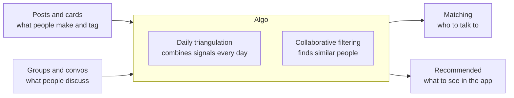

# Eniversal PRD

Nov 1, 2026 · @nivas salla

## Summary

Eniversal is one place for student builders to post, talk in depth, get matched, launch projects and meet at events. It combines jobs that LinkedIn, Reddit, Tinder and Luma each do separately.

The whiteboard is the only source for this PRD. It gives the structure but little explanation, so anything labelled "my reading" is an inference to confirm. Uncertain handwriting is listed in the last section.

## Problem and insight

Each incumbent owns one useful job, so a student builder has to stitch several products together. The sketch also marks LinkedIn's messaging, posting and "glorification" as byproducts of networking, not its point.

| Product | On the sketch | What Eniversal takes (my reading) |
| --- | --- | --- |
| LinkedIn | Networking, with messaging, posting and glorification as byproducts | Messaging and posts, without the status display |
| Reddit | Convos, leading to deep convos | Groups built for long, specific discussion |
| Tinder | Matching | Matching people, applied to builders rather than dating |
| Luma | Individuals, landing page, auth or third party, waitlist | Simple launch pages and sign-ups |
| Luma or Whop | Custom page, host event | Custom event hosting |

The sketch also shows an 18-year-old's post beside "$1B", "AI", "0.01%" and "0.000001%". My reading: today's networks bury rare young talent, and Eniversal should surface it from what people post and build.

## Target users

The first user is the student builder, the phrase underlined on the board. My reading is someone around 18 who is making projects and wants collaborators, feedback and visibility.

The first community looks like AI and cyber, which is circled several times beside the event. The sketch does not say whether non-students or investors are in scope.

## Core product

The red box on the board defines the core: messaging and posts, deep convos, and launch. Posts turned into cards and groups are ticked, so I read those as decided.

| Module | On the sketch | Requirement (my reading) |
| --- | --- | --- |
| Posts and cards | Post to cards, you to cards, ticked | Each post appears as a tagged card, and a person's cards form their profile |
| Groups and convos | Boxed and ticked, fed by deep convos | Topic groups hold long threads |
| Messaging | Inside the red box | Direct messages, likely opened after a match |
| Matching | Tinder to matching, then CF | People are recommended from their activity |
| Launch | Launch to app, features, funding and challenges | A project page shows the app, its features and what it needs |
| Projects | "Project" circled and ticked | Projects are a first-class object, linked to posts and people |
| Discovery | Idea, recommended and search all point to the app | Users can browse ideas, see recommendations and search |
| Events | Custom page, host event, 100 to event | Members can host events with sign-up and waitlist |

## Matching and recommendations

Matching runs on what people do, not what they claim. On the board, posts and groups lead to an algorithm made of daily triangulation and collaborative filtering (CF).

My reading of daily triangulation is a daily job that combines a person's posts, groups and past matches into a short list of people to meet. The one-line descriptions and the link to recommendations are also my reading.

Collaborative filtering needs activity data, so it will work poorly with the first 100 users. Early matches should rely on tags and shared groups until that data exists.

## Go-to-market

The launch number is 100: it appears against posts, cards, people and the event. My reading is a small seeded launch in this order:

1. Seed the product with 100 posts, so the first users find real content.
2. Bring in 100 student builders and turn their posts into cards.
3. Host a 100-person AI and cyber event to concentrate the first community.
4. Use the sign-ups and activity from that event as the first matching data.

## Build plan

The board starts from a barebone version, which leads to an MVP and to UI/UX work. It gives no dates or feature cut, so the split below is my proposal.

1. **Barebone:** sign-up, posts as cards, groups, search.
2. **MVP:** messaging, project pages, event hosting, first matching from daily triangulation.
3. **UI/UX:** a design pass once the barebone flows have been used.

## Success metrics and non-goals

The only targets on the board are the 100s: 100 posts, 100 people and a 100-person event. Everything else here is a proposed measure without a target.

- **Launch:** the three 100 counts above.
- **Conversation:** share of posts that lead to a real group discussion.
- **Matching:** share of recommended matches that lead to a message.
- **Building:** projects launched on Eniversal.

Proposed non-goals are a general professional network, status-driven posting and any audience beyond student builders at launch.

## Uncertain readings and open questions

These readings could change the requirements, so please correct any I got wrong. The left and right edges of the photo are also cut off, which hides some words.

| On the board | I read it as | Could also be |
| --- | --- | --- |
| "Luma" (circled next to Tinder) | Luma, the events product | Another product name |
| "wHOP" | Whop, the creator and community platform | Unrelated note about hosts |
| "cars" | Cards | Categories |
| "glorification" | Status display on LinkedIn | Another word |
| "group/channel" above the posts box | Groups or channels | Groups or clones |
| "funding, challenges" under launch | Funding and challenges for a project | Another pair of words |
| "auth/3rd party" by waitlist | Third-party sign-in or landing pages | Another phrase |
| "their" after 100 | 100 people bringing their own work | "Hair" or an unrelated word |
| "PIGA" with an arrow | Unknown | An acronym or a name |
| "Video to free" | Video is free or a later feature | Another phrase |
| "model" near 100 posts | A model trained on the first 100 posts | Another word |

- [ ] Is "Eniversal" the final spelling, or was "Universal" intended?
- [ ] Does matching connect people to collaborate, to hire, to invest, or all three?
- [ ] What data powers matching before there are enough users for collaborative filtering?
- [ ] Is this a mobile app, a web app or both?
- [ ] Is access limited to verified students?
- [ ] Is there a revenue model? The board shows none.
